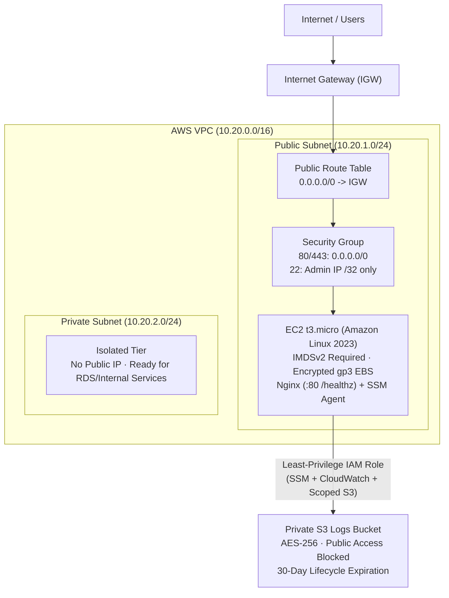

# AWS IaC VPC & Hardened Webserver Lab (Terraform + GitHub Actions)

A production-structured **Infrastructure as Code (IaC)** lab that provisions a segmented **AWS VPC**, hardened **Amazon Linux 2023 EC2** web server (`Nginx` + `/healthz`), least-privilege **IAM Role**, and encrypted **S3 Logs Bucket** using **Terraform** and automated **GitHub Actions CI** (`terraform fmt`, `terraform validate`, and **Trivy IaC** security scanning).

---

## Architecture



---

## Security & FinOps Decisions

- **Least-Privilege IAM (`terraform/iam.tf`):** EC2 uses an Instance Profile with `AmazonSSMManagedInstanceCore` (enabling keyless **SSM Session Manager** access without opening SSH to the world), `CloudWatchAgentServerPolicy`, and `s3:PutObject` scoped strictly to this lab's logs bucket ARN.
- **IMDSv2 Enforced (`terraform/compute.tf`):** `http_tokens = "required"` blocks IMDSv1 SSRF credential theft vectors.
- **Encryption at Rest:** Both the EC2 root `gp3` EBS volume and the S3 logs bucket enforce encryption (`encrypted = true`, SSE-S3 `AES256`), with all 4 S3 Public Access Block flags enabled.
- **FinOps / Free Tier Friendly:** Uses `t3.micro` (AWS Free Tier eligible), 8 GB `gp3` root volume, 30-day automatic S3 log expiration, and clean `terraform destroy` teardown.
- **Automated CI Quality Gate (`.github/workflows/terraform-ci.yml`):** Every push and PR runs `terraform fmt -check`, `terraform validate`, and a **Trivy IaC** misconfiguration scan.

---

## Quick Start

### Option 1: Deploy to AWS Free Tier
```bash
cd terraform
cp terraform.tfvars.example terraform.tfvars
# Set allowed_ssh_cidr to your public IP (e.g., $(curl -s ifconfig.me)/32)

terraform init
terraform plan
terraform apply

# Test the health endpoint
curl -i $(terraform output -raw web_health_url)

# Tear down all resources to keep cost at $0
terraform destroy
```

### Option 2: Zero-Cost Local Validation (No AWS Account Required)
You can validate formatting and syntax locally (or run against **LocalStack** via Docker):
```bash
cd terraform
terraform fmt -check -recursive
terraform init -backend=false
terraform validate
```

---

## Cloud Support Troubleshooting Playbook (RCA)

**"My EC2 web server is running, but `http://<PUBLIC_IP>/healthz` times out or returns 5xx."**

Walk through the network and OS stack layer by layer:

| Layer | What to Check | Command / AWS Check |
| :--- | :--- | :--- |
| **1. Routing & IGW** | Does the Public Subnet route table have `0.0.0.0/0 -> igw-xxxx`, and does the EC2 instance have a public IPv4? | `aws ec2 describe-route-tables --filters Name=vpc-id,Values=<vpc_id>` |
| **2. Network ACL (NACL)** | NACLs are **stateless** — verify both inbound TCP `80` and outbound ephemeral ports (`1024–65535`) are allowed. | VPC Console → Network ACLs → Inbound/Outbound Rules |
| **3. Security Group** | Security Groups are **stateful** — verify inbound TCP `80` allows the client CIDR. | `aws ec2 describe-security-groups --group-ids <sg_id>` |
| **4. OS Listener & Service** | Connect via **AWS SSM Session Manager** (no SSH key needed) and verify Nginx is active and listening on `:80`. | `sudo systemctl status nginx`<br>`sudo ss -tulpn \| grep :80`<br>`curl -i http://127.0.0.1/healthz` |
| **5. Bootstrap / User Data Logs** | If Nginx was never installed, inspect cloud-init execution logs. | `sudo tail -n 80 /var/log/cloud-init-output.log`<br>`sudo journalctl -u nginx -n 50 --no-pager` |
